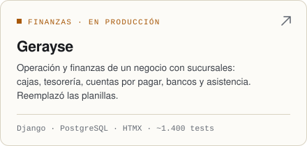
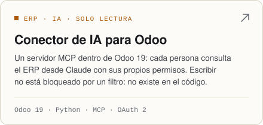
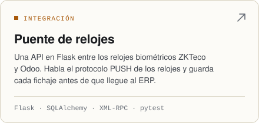
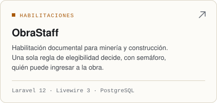
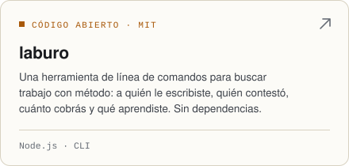
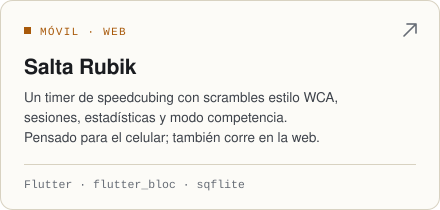

<p align="right"><a href="./README.md">English</a> · <b>Español</b></p>

<a href="https://www.froaky.com/">
  <picture>
    <source media="(prefers-color-scheme: dark)" srcset="./assets/hero-es-dark.svg">
    
  </picture>
</a>

Soy Mateo Coca, analista de sistemas y desarrollador en Salta, Argentina. Construyo las APIs y herramientas internas con las que opera un negocio cuando las planillas ya no alcanzan: tesorería, asistencia, habilitaciones. Me siento con la gente que hace el trabajo, escribo sus reglas y las pongo donde nadie se las pueda saltear.

**[froaky.com](https://www.froaky.com/)** · [CV (PDF)](https://www.froaky.com/docs/cv-es.pdf) · [mateococa.job@gmail.com](mailto:mateococa.job@gmail.com)

## Trabajo

<p>
  <a href="https://www.froaky.com/projects/gerayse"><picture><source media="(prefers-color-scheme: dark)" srcset="./assets/card-gerayse-es-dark.svg"></picture></a>
  <a href="https://www.froaky.com/"><picture><source media="(prefers-color-scheme: dark)" srcset="./assets/card-odoo-mcp-es-dark.svg"></picture></a>
</p>
<p>
  <a href="https://www.froaky.com/"><picture><source media="(prefers-color-scheme: dark)" srcset="./assets/card-zkteco-bridge-es-dark.svg"></picture></a>
  <a href="https://www.froaky.com/projects/obrastaff"><picture><source media="(prefers-color-scheme: dark)" srcset="./assets/card-obrastaff-es-dark.svg"></picture></a>
</p>
<p>
  <a href="https://github.com/Froaky/laburo"><picture><source media="(prefers-color-scheme: dark)" srcset="./assets/card-laburo-es-dark.svg"></picture></a>
  <a href="https://github.com/Froaky/timer-salta-rubik"><picture><source media="(prefers-color-scheme: dark)" srcset="./assets/card-salta-rubik-es-dark.svg"></picture></a>
</p>

Código que se puede leer acá: [gerayse1.0](https://github.com/Froaky/gerayse1.0) · [laburo](https://github.com/Froaky/laburo) · [timer-salta-rubik](https://github.com/Froaky/timer-salta-rubik) · [customer-churn-ml](https://github.com/Froaky/customer-churn-ml). El resto es de clientes y queda privado.

## Decisiones que defiendo

Cada una fue un problema en un sistema real, y lo que hice con él.

```diff
- El efectivo, los saldos bancarios y las ventas con tarjeta por acreditar se sumaban y se contaban dos veces.
+ El modelo los guarda como tres cosas distintas, y cada tablero los lee por separado.

- Un asistente de IA sobre el ERP podía escribir en él, y un filtro se puede saltear.
+ Las herramientas de escritura se borraron. Un test verifica que escribir no existe.

- Si cada pantalla recalcula quién puede entrar a la obra, alguna deja pasar un certificado vencido.
+ Una sola regla decide. La web, la API, el tablero y los reportes le preguntan a ella.

- La asistencia tenía que funcionar en el mostrador, sin cuentas para los empleados.
+ Cada empleado tiene un carnet QR. La hora la pone el servidor, y una marca se anula, nunca se edita.
```

## Stack

- **Backend:** Python (Django, Flask, FastAPI), PHP (Laravel, Livewire), Node.js
- **ERP:** módulos de Odoo 19, XML-RPC, servidores MCP
- **Datos:** PostgreSQL, SQLAlchemy, Alembic, pandas, scikit-learn
- **Frontend:** HTMX, Next.js, TypeScript, Flutter
- **Entrega:** pytest, Railway, Vercel, staging antes de producción

## Fuera del horario


Speedcubing. Compito en la WCA ([2019COCA02](https://www.worldcubeassociation.org/persons/2019COCA02)) e hice [Rankings NOA](https://rankings-noa.vercel.app), con los rankings, los récords y la historia del cubo en el Noroeste Argentino a partir de datos oficiales de la WCA, y el timer [Salta Rubik](https://github.com/Froaky/timer-salta-rubik).

Disponible para trabajar en remoto, desde Salta. Escribime a [mateococa.job@gmail.com](mailto:mateococa.job@gmail.com) o empezá por [froaky.com](https://www.froaky.com/).

<br clear="right">

<sub>Las imágenes de esta página son SVG generados por <a href="./scripts/build-assets.mjs">un solo script</a>. El registro de caja es una simulación con datos de ejemplo.</sub>
