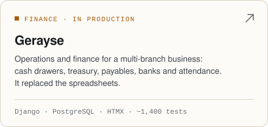
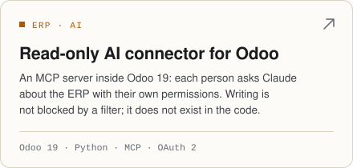
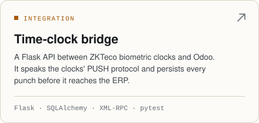
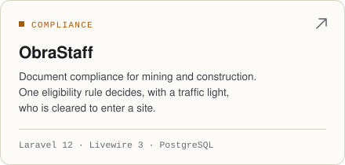
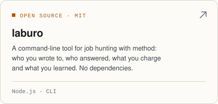
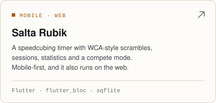

<p align="right"><b>English</b> · <a href="./README.es.md">Español</a></p>

<a href="https://www.froaky.com/">
  <picture>
    <source media="(prefers-color-scheme: dark)" srcset="./assets/hero-dark.svg">
    
  </picture>
</a>

I'm Mateo Coca, a systems analyst and developer in Salta, Argentina. I build the APIs and internal tools a business runs on once the spreadsheets stop being enough: treasury, attendance, compliance. I sit with the people who do the work, write their rules down, and put those rules where nobody can skip them.

**[froaky.com](https://www.froaky.com/)** · [CV (PDF)](https://www.froaky.com/docs/cv-en.pdf) · [mateococa.job@gmail.com](mailto:mateococa.job@gmail.com)

## Work

<p>
  <a href="https://www.froaky.com/projects/gerayse"><picture><source media="(prefers-color-scheme: dark)" srcset="./assets/card-gerayse-dark.svg"></picture></a>
  <a href="https://www.froaky.com/"><picture><source media="(prefers-color-scheme: dark)" srcset="./assets/card-odoo-mcp-dark.svg"></picture></a>
</p>
<p>
  <a href="https://www.froaky.com/"><picture><source media="(prefers-color-scheme: dark)" srcset="./assets/card-zkteco-bridge-dark.svg"></picture></a>
  <a href="https://www.froaky.com/projects/obrastaff"><picture><source media="(prefers-color-scheme: dark)" srcset="./assets/card-obrastaff-dark.svg"></picture></a>
</p>
<p>
  <a href="https://github.com/Froaky/laburo"><picture><source media="(prefers-color-scheme: dark)" srcset="./assets/card-laburo-dark.svg"></picture></a>
  <a href="https://github.com/Froaky/timer-salta-rubik"><picture><source media="(prefers-color-scheme: dark)" srcset="./assets/card-salta-rubik-dark.svg"></picture></a>
</p>

Code you can read here: [gerayse1.0](https://github.com/Froaky/gerayse1.0) · [laburo](https://github.com/Froaky/laburo) · [timer-salta-rubik](https://github.com/Froaky/timer-salta-rubik) · [customer-churn-ml](https://github.com/Froaky/customer-churn-ml). The rest belongs to clients and stays private.

## Decisions I'd defend

Each of these was a problem in a real system, and what I did about it.

```diff
- Cash, bank balances and card sales waiting to settle were easy to add up and count twice.
+ The model keeps them as three separate things, and each dashboard reads them on its own.

- An AI assistant on top of the ERP could write to it, and a filter can be bypassed.
+ The write tools were deleted. A test asserts that writing does not exist.

- If every screen recomputes who may enter a site, one of them lets in an expired certificate.
+ One rule owns the decision. Web, API, dashboard and reports all ask it.

- Attendance had to work at the counter, with no accounts for employees.
+ Each employee has a QR card. The server sets the time, and a mark can be voided, never edited.
```

## Stack

- **Backend:** Python (Django, Flask, FastAPI), PHP (Laravel, Livewire), Node.js
- **ERP:** Odoo 19 modules, XML-RPC, MCP servers
- **Data:** PostgreSQL, SQLAlchemy, Alembic, pandas, scikit-learn
- **Frontend:** HTMX, Next.js, TypeScript, Flutter
- **Delivery:** pytest, Railway, Vercel, staging before production

## Off the clock


Speedcubing. I compete in the WCA ([2019COCA02](https://www.worldcubeassociation.org/persons/2019COCA02)) and built [Rankings NOA](https://rankings-noa.vercel.app), with the rankings, records and history of the sport in north-west Argentina from official WCA data, and the [Salta Rubik](https://github.com/Froaky/timer-salta-rubik) timer.

Available for remote work, from Salta. Write to [mateococa.job@gmail.com](mailto:mateococa.job@gmail.com) or start at [froaky.com](https://www.froaky.com/).

<br clear="right">

<sub>The images on this page are SVG generated by <a href="./scripts/build-assets.mjs">one script</a>. The cash log is a simulation with sample data.</sub>
